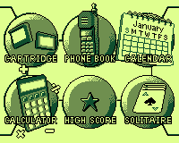
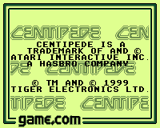
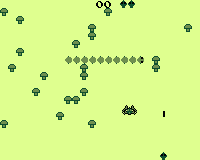

# Tiger Game.com Emulator

A clean-room, standalone emulator for the Tiger Game.com handheld. It includes an independently implemented Sharp SM8521 CPU and peripherals, a C bus and LCD core, an SDL2 desktop frontend, audio synthesis, and serial networking. **MAME is not included, linked, launched, or required.**

> **Status:** Experimental. BIOS startup and several retail games have been exercised, but compatibility, long play sessions, and cycle-perfect LCD behavior are still being validated. The project does not include firmware or commercial game ROMs.

## Features

- Clean-room SM8521 CPU, memory map, timers, interrupts, DMA, UART, and boot handling.
- Two cartridge slots, with address-mask mirroring for raw 4 KiB–2 MiB images and support for known split retail dumps.
- 200 × 160 five-shade LCD output, with selectable palettes and a hardware-native refresh rate of about 75.483 Hz.
- Keyboard and mouse/stylus input, configurable key bindings, and touchscreen tap or drag modes.
- Synthesized SG0/SG1 waveform, SG2 noise, and SGDA output through the bundled miniaudio backend.
- Persistent 8 KiB system NVRAM, optional RTC synchronization, a TCP serial link for compatible two-player games, and a virtual Hayes modem.

The CPU, serial link, audio, and LCD have automated tests. Remaining limitations include LCD scanline/fetch races, analog display response, and incomplete extended gameplay validation.

### Screenshots

| BIOS menu | Cartridge title | Gameplay test |
| --- | --- | --- |
|  |  |  |

## Run the AppImage on Linux

The recommended way to run the GUI on Linux Mint is the **`gamecom-linux-x86_64.AppImage`** from a successful [GitHub Actions build](https://github.com/Planta-dc/tgamecom/actions/workflows/manual-build.yml). Open the latest successful run, download its `gamecom-linux-<commit>` artifact, and extract it. The AppImage bundles SDL2, so you do not need to install SDL2 separately. It still requires host glibc 2.35 or newer.

```sh
chmod +x gamecom-linux-x86_64.AppImage
./gamecom-linux-x86_64.AppImage
```

If AppImage reports a FUSE problem, try:

```sh
APPIMAGE_EXTRACT_AND_RUN=1 ./gamecom-linux-x86_64.AppImage
```

The AppImage workflow runs automatically on pushes to `main` and can also be started manually with `workflow_dispatch`. Its artifact includes the AppImage and command-line tools. The raw `gamecom-sdl` program is built internally to package the AppImage but is not uploaded separately.

### Choose firmware and a game

1. Click **Browse** next to **System firmware** and select the directory containing `external.bin` or `boot.rom`. `internal.bin` is optional.
2. Optionally click **Browse** next to **Cartridge ROM** and choose a `.bin`, `.rom`, or `.tgc` image.
3. Click **Start BIOS** to enter the system menu, or **Start game** to boot the selected cartridge.

On Linux, the launcher uses a host file dialog through `zenity`, `qarma`, or `kdialog` when available; otherwise it opens its built-in browser. Windows uses the built-in browser directly. Drag-and-drop is also supported. The file dialog selects existing files and folders: **the emulator remembers their paths but does not copy or move them**. The AppImage does not include system firmware or retail game ROMs.

### Configuration and saves

On Linux, configuration is stored in `$XDG_CONFIG_HOME/gamecom-emulator/` when `XDG_CONFIG_HOME` is set, otherwise in `~/.config/gamecom-emulator/`:

- `launcher.ini` — selected firmware and cartridge paths, display/timing, audio, and serial settings.
- `controls.ini` — keyboard bindings.
- `nvram.sav` — default 8 KiB Game.com system NVRAM.

Moving or deleting a selected ROM does not move or delete it, but its saved path will no longer work until you select it again. The AppImage itself can be moved; these per-user settings remain in your home configuration directory.

The application uses the corresponding per-user configuration locations on other platforms too: `%APPDATA%\gamecom-emulator` on Windows and `~/Library/Application Support/gamecom-emulator` on macOS.

## Build from source

### Build the command-line tools and tests

```sh
make
make test
```

On Linux, GNU Make/GCC links the command-line tools statically by default. If static development libraries are unavailable, use `make PORTABLE_LDFLAGS=` to build dynamically. The CMake equivalent is `-DGAMECOM_STATIC_LINUX_EXECUTABLES=OFF`.

### Build the SDL2 desktop program

Building the GUI locally requires SDL2 **development** files; running the AppImage does not.

```sh
make sdl
./gamecom-sdl
```

CMake can build the same GUI when SDL2 development files are found:

```sh
cmake -S . -B build
cmake --build build
ctest --test-dir build --output-on-failure
```

GTK3 is optional. Without it, Linux uses the asynchronous host dialog when available and falls back to the built-in browser. The frontend includes miniaudio, so no separate audio SDK is needed.

### Useful command-line examples

```sh
./gamecom-boot firmware - 20000000 boot-frame.ppm
./gamecom-boot firmware /path/to/Centipede.bin 20000000 centipede-title.ppm \
  --touch 10000000 2 3 300000
./gamecom-sdl --firmware firmware --rom /path/to/game.bin --lcd-hz 60 --speed 120
./gamecom-sdl --demo
```

`gamecom-boot` accepts a firmware directory, an optional raw cartridge path (`-` means no cartridge), an emulation-step budget, and an optional PPM output path. Its scripted `--touch step column row duration` and `--button step name duration` events use CPU steps; overlapping touch presses are not supported. The touch grid is approximate.

The SDL executable also accepts `--rom2`, `--nvram`, `--warm-boot`, `--modem`, `--phonebook`, `--link-listen`, `--link-connect`, `--lcd-hz`, `--vsync`, `--speed`, `--pace`, `--palette`, and `--touch-mode`. Run `./gamecom-sdl --help` for the complete options and defaults.

## Desktop controls

Default keyboard bindings are the arrow keys, **A/B/C/D**, **M** (menu), **P** (pause), **S** (sound), and **N** (power). **Esc** quits. The mouse controls the touchscreen; left-click makes a single tap by default, while right-click or Shift + left-click holds/drags the stylus. Bindings can be remapped in **Input → Configure controls**.

The menu bar is organized as **File**, **Display**, **Speed**, **Input**, and **Audio**. It provides firmware and cartridge loading, BIOS/game boot, pause/reset, LCD refresh and CPU/pace controls, serial options, audio settings, window scaling, and fullscreen. Changes to settings are saved in `launcher.ini`. Status and error notices stay visible for several seconds.

## Online serial features

### Two-player Compete.com link

Both players need the same compatible two-player ROM and should enter its Compete/two-player mode.

1. On the host, choose **File → Serial: 2P host (TCP)**. The default listening port is `1997`.
2. On the client, choose **File → Serial: 2P join (TCP)** and enter the host address, such as `192.168.1.20:1997`. For two emulator windows on one computer, use `127.0.0.1:1997`.
3. If connecting over the public internet, allow/forward the chosen TCP port or use a private overlay network such as Tailscale or ZeroTier.

Command-line alternatives:

```sh
./gamecom-sdl --firmware firmware --rom Game.bin --link-listen 1997
./gamecom-sdl --firmware firmware --rom Game.bin --link-connect 192.168.1.20:1997
```

### Virtual Hayes modem

Choose **File → Serial: modem (9600 AT)** with a compatible modem/Internet cartridge. Unmapped dial strings connect to the built-in text portal. `--phonebook FILE` maps dial strings to TCP endpoints using `number=host:port` lines, for example:

```text
5551234=telehack.com:23
*=127.0.0.1:8080
```

Use `./gamecom-sdl --firmware firmware --rom Internet.bin --modem` to start with the virtual modem enabled. The portal provides basic `HELP`, `NEWS`, `GAMES`, and `TIME` commands; `QUIT` or `+++` returns to command mode.

## Hardware notes and validation

The modeled SM8521 clock is 5.000 MHz (`10 MHz` crystal divided by two). The native LCD timing is `320 × 207` cycles per frame, or about `75.483 Hz`. Tiger Game.com rotates the LCD mapping to a 200 × 160 landscape image. Slot 1 and Slot 2 are selected through the cartridge bus; system NVRAM occupies `0xE000–0xFFFF`.

The local `firmware/` directory may contain authorized development firmware, but firmware and retail game images are excluded from source archives and CI artifacts. Do not pass a BIOS ZIP as a cartridge; the cartridge loader expects a supported raw image.

Useful automated checks:

```sh
make test
# or
ctest --test-dir build --output-on-failure
```
